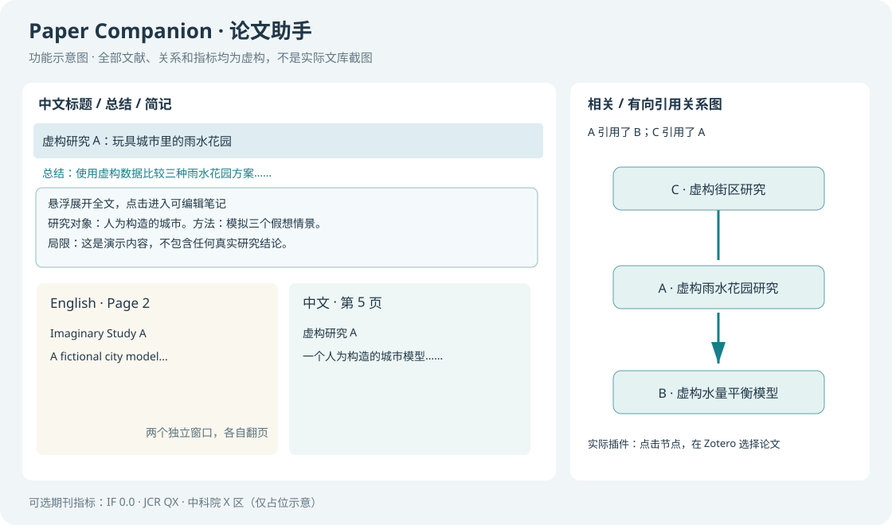

# Paper Companion · 论文助手

一个 Zotero 插件，串起原文获取、中英阅读、本地总结和文库内引用关系。面向中文阅读场景；不需要付费模型 API、手机号注册或查询密钥。

**首次公开测试版 0.1.0。支持 Zotero 10；此前核心功能在 macOS / Zotero 10.0.6 实测。公开版也已在独立临时文库验证加载、列与图谱，并用虚构 PDF 跑通翻译。Windows、Linux 安装流程尚待实机验证，不宣称全平台已验证。详见 [验证范围](docs/VALIDATION.md)。**



图示和 `examples/` 全部是人为构造的演示数据，不来自任何真实用户文库。图中的指标也是虚构展示值，不可用于评价期刊。

## 功能

| 功能 | 行为 | 边界 |
|---|---|---|
| 原文补全 | 新建论文型条目后检查并尝试 DOI、网页和开放获取原文 | 无法保证下载付费全文；不把补充材料充当正文 |
| 独立中英阅读 | 原英文 PDF 和中文 PDF 分开保存，两个 Zotero 窗口独立翻页 | 译文是机器翻译；扫描版和复杂排版可能失败 |
| 划词翻译 | 选中文字后，在阅读器弹层点击“翻译选中文本” | 文本会发送至 Bing，并非完全离线 |
| 中文标题与摘要 | 自动翻译；英文原摘要保存为子笔记 | 不用模型总结冒充作者摘要；保留用户修改 |
| 总结与简记 | 本地 Qwen3 生成结构化可编辑笔记和一句关键概括 | 未读全文时标明材料范围，不覆盖已有笔记 |
| 总结预览 | 列中显示开头，悬浮在当前行下方展示全文，点击编辑 | 可滚动；窗口底部可用空间有限 |
| 原生“相关” | 分别显示“引用的文献”和“被引用于” | 基于原文参考文献的保守匹配，可能漏识别 |
| 内嵌引用图 | 当前论文的有向图；点击节点选择 Zotero 条目并更新图 | 图中没有连线不等于没有引用 |
| 期刊指标 | 可选显示 IF、JCR、中科院分区，每周检查第三方源 | 不附带第三方数据库；无官方数据保证，不伪造缺失值 |

保留手工关联和原始 PDF、批注、已编辑总结。只处理个人文库，暂不支持群组库的自动处理。

## 安装

下载同一次 Release 的 `paper-companion-0.1.0.xpi` 和 `paper-companion-runtime-0.1.0.zip`。只需一个 Zotero 插件；本机运行组件是独立进程，不是另一个 Zotero 插件。

1. 在 Zotero「工具 → 插件」安装 XPI。
2. 安装 [Python 3.12](https://www.python.org/downloads/) 和 [Ollama](https://ollama.com/download)。在终端运行 `ollama pull qwen3:4b`，模型约数 GB。
3. 解压运行组件，在其目录运行：

   ```sh
   python3 service/install.py --start
   ```

   Windows 使用 `py -3.12 service/install.py --start`。首次安装会下载 PDF 翻译引擎和依赖，可能需要较多磁盘空间及可用网络。
4. 服务启动后打印一个本机 `connection.json` 文件位置。在 Zotero「工具 → Paper Companion：首次设置与隐私」中阅读说明并选择这个文件。
5. 可选择是否启用期刊指标第三方数据源。未完成设置前，插件不自动传送文献文本或下载数据。

以后启动翻译服务的方法会由安装脚本打印；Ollama 也需要保持运行。关闭终端后服务停止；原文/笔记/引用图仍保存在本机，下一次启动服务后可继续处理。

**不要把 connection.json、token、运行目录、文库、PDF 或日志上传到仓库或 issue。**

## 使用

- 右键条目 → 中英双窗口对照。
- 右侧“相关”查看引用与被引；其下“引用关系图”按钮打开当前论文的图。
- 悬浮“总结”列查看笔记，点击编辑。
- “简记”和“中文标题”列在没有其他插件提供同名功能时由本插件提供；Extra 中的 `remark` 仍可编辑。
- 工具菜单可以手动加入处理队列、打开总结、查看期刊数据版本。

## 隐私与数据流

见 [PRIVACY.md](PRIVACY.md)。没有遥测，不把用户文库上传到本仓库。**免费不是离线**：翻译文本交给 Bing，全文获取连接出版商/开放获取站点；期刊更新下载公开数据；总结默认仅调用 `127.0.0.1:11434`。

本机桥接服务仅绑定 `127.0.0.1`，每次安装随机生成令牌，拒绝带浏览器 Origin 的调用。不要把端口转发到公网。

## 开发与打包

```sh
node --test tests/*.cjs
python3 -m unittest discover -s tests -p 'test_*.py'
python3 scripts/build.py
```

构建使用文件白名单，产物位于 `dist/`，并检查私有路径、运行状态和意外附件。请只提交仓库内的源代码，不从个人运行目录整体复制。

各模块注释和 [docs/ARCHITECTURE.md](docs/ARCHITECTURE.md) 说明队列、编辑保护、引用方向与更新策略。许可证为 AGPL-3.0-only；第三方说明见 [THIRD_PARTY.md](THIRD_PARTY.md)。

## 发布渠道

这不是 Zotero 官方插件。Zotero 官方目前尚未开放插件目录；公开下载通过 GitHub Releases。官方说明：<https://www.zotero.org/support/plugins>。不能把第三方目录收录或论坛介绍称为“官方认证”。
