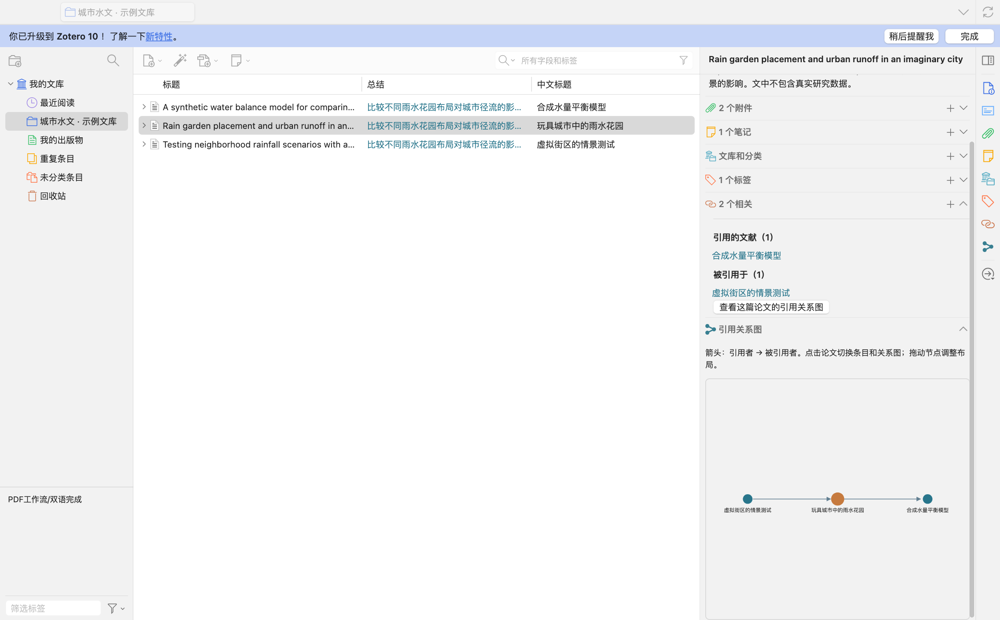
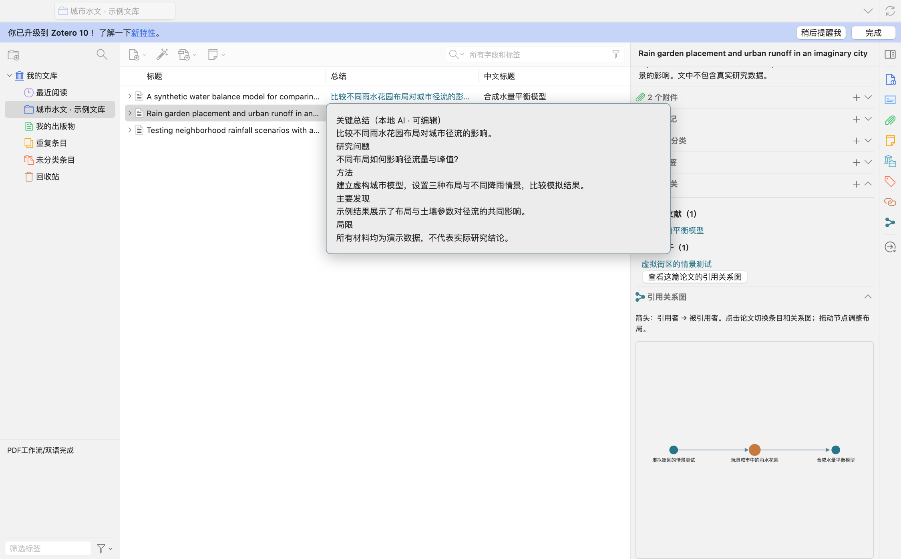

# Paper Companion · 论文助手

为 Zotero 提供中文阅读、可编辑总结和文库内引用关系图。



<details>
<summary>查看总结悬浮预览</summary>



</details>

截图使用示例文献。

## 功能

- **原文补全**：添加论文后，自动查找可获取的 PDF 原文。
- **中英对照**：英文原文与中文译文分别保存，在两个 Zotero 窗口中独立翻页。
- **划词翻译**：选中文字后，点击“翻译选中文本”。
- **中文标题和摘要**：自动翻译标题及摘要，英文摘要保存为子笔记。
- **总结与简记**：使用本机模型生成可编辑总结及一句话概括。总结列支持悬浮预览和点击编辑。
- **引用关系**：在“相关”面板查看引用与被引文献；点击关系图节点可定位到对应条目。
- **期刊指标**：可选显示影响因子、JCR 和中科院分区，每周检查数据更新。

自动处理个人文库中的论文条目。已有的手工关联、原文、批注和编辑过的总结会保留。

## 安装

自动设置支持 **macOS 14 或更高版本、Apple Silicon（M 系列芯片）和 Zotero 10**。首次设置需要联网下载数 GB 文件，请预留至少 12 GiB 可用磁盘空间。

1. 从 [Releases](https://github.com/ltzyl/zotero-paper-companion/releases/latest) 下载 `paper-companion-*.xpi`。
2. 在 Zotero「工具 → 插件」中，点击齿轮菜单，选择「从文件安装插件」，打开下载的 `.xpi`。
3. 打开「工具 → Paper Companion：设置与运行状态」，阅读说明并点击「开始自动设置」。

插件会安装独立的 Python、PDF 翻译组件、Ollama 和 `qwen3:4b` 本地模型。窗口显示当前阶段及下载进度；关闭设置窗口后会在后台继续，可从工具菜单重新查看或取消。完成后即可使用；以后随 Zotero 自动启动，无需打开终端。关闭 Zotero 或禁用插件时，本插件启动的服务会退出。

模型和翻译数据存放在每个 Zotero 配置的独立目录中。Ollama 的身份文件使用当前用户共用的 `~/.ollama/id_ed25519` 和 `~/.ollama/id_ed25519.pub`：已有私钥会沿用；私钥不存在时会生成私钥并写入公钥，可能替换单独遗留的公钥文件。插件关闭 Ollama 云功能；卸载插件不会自动删除这些共用身份文件。详情见 [隐私说明](PRIVACY.md)。

Python 依赖会自动选择 PyPI 或清华大学开源软件镜像站中较快的可用源，安装时仍核对固定版本和哈希，无需注册。网络中断时可在同一窗口重试。下载内容经过校验，已完成的组件会尽量复用。Windows、Linux 和 Intel Mac 暂不支持自动设置。

如果提示“代理虚拟 IP”，在「高级设置 → 模型下载代理」填写代理软件的本机 HTTP 地址（例如 `http://127.0.0.1:7897`），然后重试。该选项仅用于模型下载，无需修改系统代理设置。

已自行运行兼容服务的用户，可在「高级设置」中导入 `connection.json`。这类服务由用户自行启动和停止。

普通安装只需要 `.xpi`。`SHA256SUMS` 是可选的完整性校验清单；`updates.json` 用于 Zotero 自动检查插件更新，无需手动安装。

## 使用

| 操作 | 入口 |
|---|---|
| 打开中英对照 | 右键条目 → 中英双窗口对照 |
| 查看完整总结 | 悬浮“总结”列 |
| 编辑总结 | 点击“总结”列 |
| 编辑简记 | 修改条目 Extra 中的 `remark` |
| 查看引用和被引 | 右侧“相关”面板 |
| 打开当前论文的引用图 | 右侧“引用关系图” |
| 手动加入处理队列、刷新期刊指标 | 工具菜单 |

## 服务与数据

翻译使用 Bing；PDF 正文、标题、摘要及选中文字会发送至该服务。本地总结使用 Ollama，无需模型 API 密钥。完整数据流与本机缓存位置见 [隐私说明](PRIVACY.md)。

原文获取受全文访问权限限制。扫描版 PDF 可能需要额外处理。引用关系来自文库内原文的参考文献匹配，未识别到连线不代表没有引用。期刊指标按第三方来源的版本显示，来源见 [第三方组件与数据](THIRD_PARTY.md)。

## 开发

```sh
node --test tests/*.cjs
python3 -m unittest discover -s tests -p 'test_*.py'
python3 scripts/build.py
```

构建产物位于 `dist/`。模块说明见 [架构文档](docs/ARCHITECTURE.md)。

## 许可证

[AGPL-3.0-only](LICENSE)。
